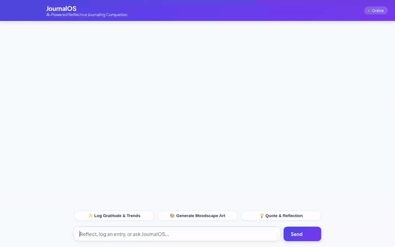

# 🌿 JournalOS Sanctuary — Privacy-First Mindful AI Companion & 19-Framework Journaling Studio

<p align="center">
  
</p>

**JournalOS Sanctuary** is a **100% free, open-source, zero-trust privacy-first Mindful AI Journaling Web Application**. Built to act as an empathetic, non-judgmental **Companion Counsellor & Life Coach**, it dynamically guides you across **19 evidence-based journaling methodologies**—backed by your own private **Google Sheet** (or isolated local vault) and **Google AI Studio's free Gemini 2.5 Flash API**.



---

## ✨ Key Highlights

- 🤝 **Dynamic First-Time Setup & Empathetic Companion Counsellor**: Welcomes each user by asking for their preferred name on first launch (changeable anytime in **⚙️ Privacy & Cloud Settings**), standing beside you as a non-judgmental listener and coach.
- 🧭 **19 Evidence-Based Journaling Methodologies + Circadian `⏰ NOW` Recommendations**: Automatically detects your browser's local time and timezone to recommend the ideal journaling practice for morning, midday, evening, or night.
- 🎨 **Rate-Limit-Free Animated SVG Moodscapes (`/api/moodscape.svg`)**: Generates living, 60fps breathing visuals with full multi-line reflection questions and meanings—with zero external API rate limits or third-party tracking.
- 🎭 **Nuanced Emotion Vocabulary**: 10 expressive emotional states with guided reflection phrases to help you articulate complex inner feelings.
- 🔒 **Zero-Trust Mental-Health Privacy & At-Rest Encryption**:
  - **Client-Side AES-256-GCM Encryption**: Optional PBKDF2 (100,000 iterations) + WebCrypto AES-256-GCM encryption encrypts your journal text *inside your browser* before it ever leaves your device.
  - **Encrypted Local Config & PII at Rest**: User names, API keys, and Google Sheets webhook URLs are encrypted on disk (`VAULT_ENC:v1:...`) using HMAC-SHA256 authenticated encryption.
  - **Per-Browser Cryptographic Vault Isolation**: Each browser gets an isolated vault (`X-JournalOS-Vault-ID`) so users on shared servers never see each other's data.
  - **Instant `Esc` Key Privacy Shield**: Press `Esc` anytime to immediately lock your screen behind a full-screen privacy shield with PIN unlock.
  - **Strict PII-Redacted Diagnostics (`journalos/logs/`)**: Operational logs automatically strip all journal content, emotions, names, and credentials (`[REDACTED_FOR_PRIVACY]`).
- 📅 **1-Click Google Calendar Ritual Booking**: Schedule daily or weekly journaling reminders directly into Google Calendar (or download a universal `.ics` calendar file).

---

## 💰 100% Free ($0/Month) Open-Source Tech Stack

| Layer | Technology Used | Cost |
| :--- | :--- | :--- |
| **Web UI & Encryption** | Vanilla HTML5 / CSS3 / ES6 + WebCrypto API (`AES-256-GCM`) + Custom SVG Emblem | **$0** |
| **Application Server** | Dual-Mode Python Server: Standard Library `ThreadingHTTPServer` OR `FastAPI`/`Uvicorn` | **$0** |
| **AI Companion Engine** | Google AI Studio Free Tier (`gemini-2.5-flash`) + Built-in Offline Companion Coach Fallback | **$0** |
| **Cloud Database Sync** | Personal Google Sheets via Google Apps Script Web App (`scripts/google_apps_script.gs`) | **$0** |
| **Visual Moodscapes** | Local Procedural 60fps Animated SVG Generator (`/api/moodscape.svg`) | **$0** |
| **Calendar Reminders** | Google Calendar Deep-Link Renderer + RFC 5545 `.ics` Generator | **$0** |

---

## ⚡ Quick Start (Runs in 5 Seconds — Zero `pip install` Required!)

### 1. Run Locally
From the repository root, run:

```bash
python journalos/frontend/main.py
```

Open **http://localhost:8080** in your browser.
On first launch, **JournalOS Sanctuary** will ask for your preferred name (and optional Privacy PIN) and greet you with a time-aware reflection session.

---

## 📊 Optional: Connect Your Private Google Sheet as a $0 Cloud Database (60 Seconds)

JournalOS works immediately out-of-the-box using your private local vault and syncs with your own Google Sheet whenever you connect it:

1. Create a blank Google Sheet at **[sheets.new](https://sheets.new)**.
2. In your Google Sheet menu, click **Extensions → Apps Script**.
3. Click **⚙️ Privacy & Cloud** in the top-right corner of the JournalOS web app and click **"Copy Google Apps Script Code"** (or copy from [`journalos/scripts/google_apps_script.gs`](journalos/scripts/google_apps_script.gs)), paste it into `Code.gs`, and click **Save (💾)**.
   - *(Optional Security)*: Set `const SECRET_VAULT_TOKEN = "your-secret-passphrase";` at the top of the script.
4. Click **Deploy → New deployment**:
   - Select type: **Web app**
   - Execute as: **Me**
   - Who has access: **Anyone**
5. Copy the **Web app URL** (`https://script.google.com/macros/s/.../exec`), paste it into **⚙️ Privacy & Cloud** in JournalOS (along with your optional [Free Google AI Studio Gemini API Key](https://aistudio.google.com/apikey)), and click **Save Privacy & Cloud Settings**.

Your Google Sheet will automatically maintain three structured tabs:
- `Journal_Entries` (`entry_id`, `timestamp`, `title`, `methodology`, `mood`, `content`, `tags`, `word_count`)
- `Memories_Insights` (`memory_id`, `timestamp`, `domain`, `fact`)
- `Habits_Goals` (`item_id`, `updated_at`, `title`, `category`, `status`, `streak`)

---

## 🧭 Supported 19 Mindful Journaling Methodologies

Grouped into **5 Mindful Pillars** in the interactive left sidebar:

1. **Clarity & Mindful Presence**: Morning Pages, Mindfulness Journaling, Expressive Writing, Stream-of-Consciousness
2. **Emotional Intelligence & Gratitude**: Gratitude Journaling, Reflective Journaling, Mood Journaling, Prompted Journaling
3. **Intentional Living & Productivity**: Bullet Journaling, Goal Journaling, Habit Journaling, Daily Journaling, One-Line-a-Day
4. **Wisdom, Learning & Curiosity**: Learning Journaling, Reading Journaling, Commonplace Journaling
5. **Imagination & Life Story**: Dream Journaling, Travel Journaling, Creative Journaling

---

## 🛡️ Security & Mental-Health Privacy Architecture

Because a journaling app records deeply personal thoughts and emotional states, **JournalOS** enforces five layers of defense:

1. **Zero Hardcoded PII & Git-Ignored Vaults**: User names, reflections, API keys, and logs (`journalos/data/*.json`, `journalos/data/*.key`, `journalos/logs/*`) are excluded from version control via `.gitignore`.
2. **At-Rest Authenticated Encryption (`VAULT_ENC:v1`)**: [`sheets_storage.py`](journalos/app/sheets_storage.py) encrypts all saved user names, webhook URLs, and API keys on disk using `PBKDF2-HMAC-SHA256` + `HMAC-SHA256`.
3. **End-to-End Browser Encryption (`ENC:v1`)**: When enabled in **⚙️ Privacy & Cloud**, your journal text is encrypted with `AES-256-GCM` in your browser before being sent to the server or Google Sheets.
4. **Panic Lock (`Esc` Key)**: Pressing `Esc` anywhere immediately hides your screen behind a full-screen Privacy Shield.
5. **One-Click Device Wipe**: Clicking **Wipe Local Device Data** in Settings permanently deletes your local vault and rotates your browser Vault ID.

---

## 🧪 Running Unit & Privacy Verification Tests

```bash
cd journalos
python -m unittest tests/unit/test_dummy.py -v
```

---

## 🌐 Free Cloud Deployment (Render / Railway / Hugging Face Spaces)

- **Build Command**: `pip install -r journalos/requirements.txt`
- **Start Command**: `python journalos/frontend/main.py`
- **Optional Environment Variables**:
  - `GEMINI_API_KEY`: Free key from [Google AI Studio](https://aistudio.google.com/apikey)
  - `GOOGLE_SHEETS_WEBHOOK_URL`: Your Google Apps Script Web App URL
  - `JOURNALOS_MASTER_KEY`: Custom secret passphrase for server-side at-rest config encryption
