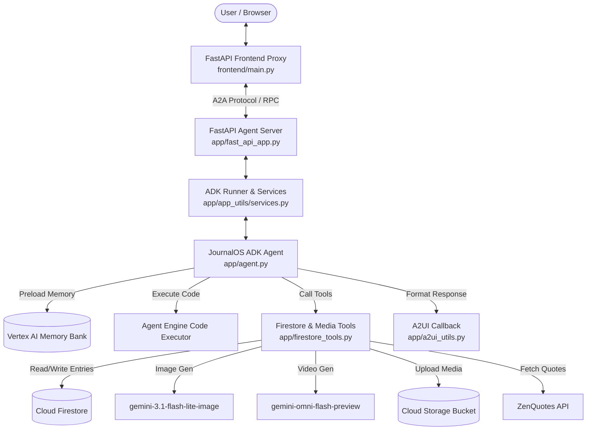

# JournalOS - Agentic AI Journaling System

An advanced Agentic AI Journaling System built with Google Cloud ADK (Agent Development Kit), Vertex AI, and Gemini (`gemini-2.5-flash`). JournalOS acts as a personal reflection coach, goal accountability partner, and mental wellness companion by dynamically adapting across 19 journaling methodologies.


---

## 📚 Table of Contents

- [🧩 Architecture & Flow Overview](#-architecture--flow-overview)
- [🚀 Implemented Features & Service Matrix](#-implemented-features--service-matrix)
- [⏳ Planned / Unimplemented Capabilities](#-planned--unimplemented-capabilities)
- [🔬 Core Component Breakdown](#-core-component-breakdown)
  - [1. Agent Engine & Prompt Logic](#1-agent-engine--prompt-logic)
  - [2. Firestore & Media Generation Tools](#2-firestore--media-generation-tools)
  - [3. Agent-to-User Interface (A2UI v0.8) Callback](#3-agent-to-user-interface-a2ui-v08-callback)
  - [4. Vertex AI Memory Bank Integration](#4-vertex-ai-memory-bank-integration)
  - [5. Serving Infrastructure & Frontend Proxy](#5-serving-infrastructure--frontend-proxy)
- [⚙️ Configuration & Environment Variables](#️-configuration--environment-variables)
- [🛠️ Developer Extension Playbook (How to Modify & Enhance)](#️-developer-extension-playbook-how-to-modify--enhance)
  - [Adding a New Tool](#adding-a-new-tool)
  - [Customizing A2UI Cards](#customizing-a2ui-cards)
  - [Adding Vertex AI RAG Engine Retrieval](#adding-vertex-ai-rag-engine-retrieval)
  - [Expanding Evaluation Datasets](#expanding-evaluation-datasets)
- [📂 Repository Structure](#-repository-structure)
- [💻 Local Setup & Execution Guide](#-local-setup--execution-guide)
- [🧪 Testing & Quality Evaluation](#-testing--quality-evaluation)
- [🚢 Deployment & Publishing](#-deployment--publishing)

---

## 🧩 Architecture & Flow Overview

JournalOS uses a multi-layered agent architecture designed for real-time interaction, cross-session long-term memory persistence, and dynamic rich-UI generation.



### Request Execution Lifecycle
1. **Memory Preload**: At conversation start, `PreloadMemoryTool` pulls the user's cross-session memories (goals, mood history, reading logs, habits, behavior patterns) into context.
2. **Model Reasoning**: `gemini-2.5-flash` evaluates user input against the 19 journaling methodologies and decides which tools to invoke or Python code to execute.
3. **Tool Execution**: Tools perform structured document operations in Cloud Firestore, generate visual moodscapes via Vertex AI GenAI SDK, or fetch external quotes. Generated media is saved as session artifacts and uploaded to Google Cloud Storage.
4. **UI Rewrapping**: The `after_model_callback` (`a2ui_callback` in `app/a2ui_utils.py`) intercepts A2UI JSON output, validates component tree hierarchy, sanitizes image URLs, and wraps it into A2A data parts.
5. **Memory Consolidation**: Upon turn completion, `after_agent_callback` (`generate_memories_callback`) commits the session events to Vertex AI Memory Bank for long-term synthesis.

---

## 🚀 Implemented Features & Service Matrix

The table below lists **ONLY** the services, tools, and capabilities currently wired up in code:

| Component / Service | Implementation Source | Primary Function & Capabilities |
| :--- | :--- | :--- |
| 🧠 **Vertex AI Memory Bank** | `google.adk.memory.VertexAiMemoryBankService`, `PreloadMemoryTool` in [app/agent.py](file:///config/Desktop/Session1/journalos/app/agent.py) | Remembers and synthesizes user context across sessions in 6 core domains: User Goals, Mood History, Methodologies & Preferences, Reading Logs, Habits/Routines, and Recurring Behavioral Patterns. |
| 🗄️ **Cloud Firestore Database** | `google.cloud.firestore` in [app/firestore_tools.py](file:///config/Desktop/Session1/journalos/app/firestore_tools.py) | Document storage for journal entries (`add_journal_entry`, `list_journal_entries`, `get_journal_entry`). |
| 🖼️ **Google Cloud Storage (GCS)** | `google.cloud.storage` in [app/firestore_tools.py](file:///config/Desktop/Session1/journalos/app/firestore_tools.py) | Stores session media artifacts and uploads visual moodscapes to bucket `journalos-media-qwiklabs-gcp-02-f96e03251dae`. |
| 🎨 **Visual Moodscape & Video Gen** | `gemini-3.1-flash-lite-image` & `gemini-omni-flash-preview` in [app/firestore_tools.py](file:///config/Desktop/Session1/journalos/app/firestore_tools.py) | Generates image artwork (`generate_journal_image`) and moodscape MP4 videos (`generate_journal_video`), returning public GCS links. |
| 🪟 **Agent-to-User Interface (A2UI v0.8)** | `A2uiSchemaManager`, `a2ui_callback` in [app/a2ui_utils.py](file:///config/Desktop/Session1/journalos/app/a2ui_utils.py) | Intercepts A2UI JSON output and formats structured UI cards (`Card`, `Column`, `Row`, `Text`, `Image`) for display clients. |
| 🧪 **Python Code Executor** | `AgentEngineSandboxCodeExecutor` in [app/agent.py](file:///config/Desktop/Session1/journalos/app/agent.py) | Runs generated Python code in a secure sandbox for calculations, date/time math, or data analysis. |
| 📜 **ZenQuotes API Integration** | `fetch_inspirational_quote` in [app/firestore_tools.py](file:///config/Desktop/Session1/journalos/app/firestore_tools.py) | Fetches real-time inspirational quotes with graceful fallback handling. |
| 💡 **Curated Reflection Engine** | `generate_reflective_prompt` in [app/firestore_tools.py](file:///config/Desktop/Session1/journalos/app/firestore_tools.py) | Generates targeted reflection prompts by category (gratitude, mindfulness, goals, learning, morning, dream, general). |
| 📖 **19 Journaling Methodologies** | System Instruction in [app/agent.py](file:///config/Desktop/Session1/journalos/app/agent.py) | Guides user reflection across 19 frameworks (Daily, Reflective, Prompted, Stream-of-Consciousness, Morning Pages, Gratitude, Mindfulness, Mood, Bullet, Goal, Habit, Learning, One-Line-a-Day, Dream, Travel, Reading, Commonplace, Creative). |

---

## ⏳ Planned / Unimplemented Capabilities

The following features were outlined in `project_brief.md` as future roadmap enhancements:

* **Vertex AI RAG Engine Corpus**: Grounded document retrieval over personal journal archives or book notes (*planned, not yet implemented*).
* **Dedicated Habit Streak & Reading List Schemas**: Standalone Firestore collections dedicated exclusively to habit streak counters or reading list indexes (*planned, not yet implemented*; currently captured inside tagged Firestore journal entries and Memory Bank recall).

---

## 🔬 Core Component Breakdown

### 1. Agent Engine & Prompt Logic
Location: [app/agent.py](file:///config/Desktop/Session1/journalos/app/agent.py)
* Defines `root_agent` using `Gemini(model="gemini-2.5-flash")` with HTTP retry options.
* System prompt defines persona guidelines, A2UI component rules, and 19 journaling framework instructions.
* Attached tools: `PreloadMemoryTool()`, `generate_journal_image`, `generate_journal_video`, `fetch_inspirational_quote`, `generate_reflective_prompt`, `list_journal_entries`, `get_journal_entry`, `add_journal_entry`.
* Configures `AgentEngineSandboxCodeExecutor` by loading `remote_agent_runtime_id` and `sandbox_resource_name` from `deployment_metadata.json`.

### 2. Firestore & Media Generation Tools
Location: [app/firestore_tools.py](file:///config/Desktop/Session1/journalos/app/firestore_tools.py)
* **`add_journal_entry`**: Saves title, content, methodology, mood, tags, and ISO timestamp to Firestore collection `journal_entries`.
* **`list_journal_entries`**: Queries recent journal entries ordered by timestamp descending.
* **`get_journal_entry`**: Retrieves specific document by `entry_id`.
* **`generate_journal_image`**: Calls `gemini-3.1-flash-lite-image` in global region via Vertex AI GenAI SDK, saves session artifact, uploads to GCS bucket `journalos-media-qwiklabs-gcp-02-f96e03251dae`, and returns public HTTPS URL.
* **`generate_journal_video`**: Calls `gemini-omni-flash-preview` in global region via Vertex AI GenAI SDK interactions API, decodes video bytes, uploads MP4 to GCS bucket, and returns public HTTPS URL.
* **`fetch_inspirational_quote`**: Connects to `https://zenquotes.io/api/random`.
* **`generate_reflective_prompt`**: Returns tailored prompts for categories.

### 3. Agent-to-User Interface (A2UI v0.8) Callback
Location: [app/a2ui_utils.py](file:///config/Desktop/Session1/journalos/app/a2ui_utils.py)
* Runs as `after_model_callback` on every model turn.
* Strips markdown code blocks and `<a2a_datapart_json>` tags.
* Auto-injects `beginRendering` message if missing.
* Validates component trees (`Card`, `Column`, `Row`, `Text`, `Image`) to prevent blank-card or un-rendered surface errors.
* Sanitizes `Image` components: replaces non-HTTP relative image paths with text notes while preserving public HTTPS URLs.

### 4. Vertex AI Memory Bank Integration
Location: [app/app_utils/services.py](file:///config/Desktop/Session1/journalos/app/app_utils/services.py)
* Configures `VertexAiMemoryBankService` pointing to `GOOGLE_CLOUD_PROJECT` and `GOOGLE_CLOUD_AGENT_ENGINE_ID`.
* Interacts with `PreloadMemoryTool` at turn start and `generate_memories_callback` (`await callback_context.add_session_to_memory()`) at turn end.

### 5. Serving Infrastructure & Frontend Proxy
Location: [app/fast_api_app.py](file:///config/Desktop/Session1/journalos/app/fast_api_app.py) & [frontend/main.py](file:///config/Desktop/Session1/journalos/frontend/main.py)
* `fast_api_app.py`: Creates FastAPI app with ADK `Runner`, attaching A2A routes (`/a2a/app`) and Reasoning Engine proxy routes (`/predict`, `/streamQuery`).
* `frontend/main.py`: Lightweight FastAPI proxy server listening on port 8080 that forwards chat messages to the backend over A2A and serves `frontend/static/index.html`.

---

## ⚙️ Configuration & Environment Variables

Create a `.env` file in `journalos/` (or copy from `.env.example`):

```bash
GOOGLE_CLOUD_PROJECT="qwiklabs-gcp-02-f96e03251dae"
GOOGLE_CLOUD_LOCATION="us-east1"
GOOGLE_CLOUD_AGENT_ENGINE_ID="890874898358992896"
LOGS_BUCKET_NAME="journalos-media-qwiklabs-gcp-02-f96e03251dae"
ALLOW_ORIGINS="*"
ZENQUOTES_API_KEY=""
```

| Variable Name | Description | Default / Example |
| :--- | :--- | :--- |
| `GOOGLE_CLOUD_PROJECT` | GCP Project ID for Firestore, Vertex AI, and GCS | `qwiklabs-gcp-02-f96e03251dae` |
| `GOOGLE_CLOUD_LOCATION` | Region for Agent Engine and Memory Bank | `us-east1` |
| `GOOGLE_CLOUD_AGENT_ENGINE_ID` | Deployed Reasoning Engine resource ID | `890874898358992896` |
| `LOGS_BUCKET_NAME` | Cloud Storage bucket for media uploads | `journalos-media-qwiklabs-gcp-02-f96e03251dae` |
| `SESSION_SERVICE_URI` | Service URI for ADK sessions | `shared://session` |
| `MEMORY_SERVICE_URI` | Service URI for ADK Memory Bank | `shared://memory` |
| `ALLOW_ORIGINS` | CORS allowed origins for FastAPI | `*` |
| `ZENQUOTES_API_KEY` | Optional API key for ZenQuotes | *(Optional)* |

---

## 🛠️ Developer Extension Playbook (How to Modify & Enhance)

### Adding a New Tool
To add a new tool (e.g. `analyze_journal_sentiment`):

1. **Define the tool function** in [app/firestore_tools.py](file:///config/Desktop/Session1/journalos/app/firestore_tools.py) (or a new module):
   ```python
   def analyze_journal_sentiment(text: str) -> str:
       """Analyzes emotional tone and returns sentiment scores.
       
       Args:
           text: The journal text to analyze.
       """
       # Implementation logic
       return json.dumps({"sentiment": "Positive", "score": 0.88})
   ```

2. **Register the tool** in [app/agent.py](file:///config/Desktop/Session1/journalos/app/agent.py):
   ```python
   from app.firestore_tools import analyze_journal_sentiment

   root_agent = Agent(
       ...
       tools=[
           PreloadMemoryTool(),
           analyze_journal_sentiment,  # <--- Add here
           ...
       ]
   )
   ```

3. **Update System Prompt**: If the tool requires specific output formatting or trigger conditions, describe it in `SYSTEM_INSTRUCTION` inside [app/agent.py](file:///config/Desktop/Session1/journalos/app/agent.py).

---

### Customizing A2UI Cards
To add or modify A2UI card layouts:

1. Update `a2ui_instruction` prompt in [app/agent.py](file:///config/Desktop/Session1/journalos/app/agent.py) to specify allowable component structures:
   ```python
   # Example: Adding Table or Row guidelines
   ui_description="Keep surfaces clean: Card > Column > Text / Image rows..."
   ```
2. If adding new A2UI message kinds or schema fields, ensure [app/a2ui_utils.py](file:///config/Desktop/Session1/journalos/app/a2ui_utils.py) handles them:
   ```python
   _A2UI_KEYS = ("beginRendering", "surfaceUpdate", "dataModelUpdate", "deleteSurface")
   ```

---

### Adding Vertex AI RAG Engine Retrieval
When implementing the planned RAG Engine document grounded retrieval:

1. Create RAG retrieval tool in `app/rag_tools.py`:
   ```python
   from google.genai import types
   from google import genai

   def search_journal_corpus(query: str) -> str:
       """Retrieves relevant personal entries/notes from RAG Engine corpus."""
       client = genai.Client(vertexai=True, project=PROJECT_ID, location="us-east1")
       # Query Vertex AI RAG corpus
       return json.dumps({"results": [...]})
   ```
2. Add `search_journal_corpus` to `root_agent.tools` in [app/agent.py](file:///config/Desktop/Session1/journalos/app/agent.py).

---

### Expanding Evaluation Datasets
To evaluate agent response quality and tool execution accuracy:

1. Add ground-truth evaluation examples to [tests/eval/datasets/basic-dataset.json](file:///config/Desktop/Session1/journalos/tests/eval/datasets/basic-dataset.json):
   ```json
   {
     "query": "Show my recent journal entries from this week",
     "expected_tool_calls": ["list_journal_entries"]
   }
   ```
2. Run evaluation using `agents-cli`:
   ```bash
   agents-cli eval
   ```

---

## 📂 Repository Structure

```text
journalos/
├── app/
│   ├── agent.py               # Main ADK agent definition & system instructions
│   ├── a2ui_utils.py          # A2UI v0.8 rendering callback & surface sanitizer
│   ├── firestore_tools.py     # Tools: Firestore CRUD, image/video gen, GCS, ZenQuotes, Prompts
│   ├── fast_api_app.py        # FastAPI server exposing native ADK & A2A endpoints
│   └── app_utils/             # Shared session, memory, and artifact service registry
├── frontend/
│   ├── main.py                # FastAPI proxy forwarding browser chats over A2A protocol
│   └── static/index.html      # Lightweight web UI rendering text & A2UI cards
├── assets/
│   └── demo.gif               # Recorded demo walkthrough GIF
├── recordings/
│   └── page@0d63b020dbd...    # Raw webm recording file
├── scripts/
│   └── seed_firestore.py      # Database seeding script for sample journal entries
├── tests/
│   ├── unit/                  # Unit test suite
│   ├── integration/           # Integration and E2E test suite
│   └── eval/                  # Quality evaluation datasets and configs
├── agents-cli-manifest.yaml   # Agent manifest configuration
├── pyproject.toml             # Python dependencies and tool configurations
└── Dockerfile                 # Container specification for Cloud Run deployment
```

---

## 💻 Local Setup & Execution Guide

### 1. Prerequisites

- Python `>=3.11` (managed via `uv`)
- `agents-cli` installed (`uv tool install google-agents-cli`)
- Authenticated Google Cloud credentials:
  ```bash
  gcloud auth login
  gcloud auth application-default login
  ```

### 2. Install Dependencies

```bash
uv sync
```

### 3. Seed Firestore Database (Optional)

Populate Firestore with sample journal entries:

```bash
python scripts/seed_firestore.py
```

### 4. Run Development Playground (ADK Dev UI)

Launch the interactive local development playground:

```bash
agents-cli playground
```

### 5. Run Backend FastAPI Server

Start the native agent API backend:

```bash
uvicorn app.fast_api_app:app --host 0.0.0.0 --port 8000
```

### 6. Run Web Frontend Proxy

Start the frontend proxy server:

```bash
export AGENT_ENGINE_RESOURCE_NAME="projects/<your-project-id>/locations/us-east1/reasoningEngines/<id>"
export AGENT_DIRECTORY="app"
python frontend/main.py
```

---

## 🧪 Testing & Quality Evaluation

Run unit and integration test suites:

```bash
uv run pytest tests/unit tests/integration
```

Run agent quality evaluation:

```bash
agents-cli eval
```

---

## 🚢 Deployment & Publishing

Deploy the agent to Google Cloud Agent Runtime / Agent Engine:

```bash
agents-cli deploy
```

Register the agent with Gemini Enterprise:

```bash
agents-cli publish gemini-enterprise
```
