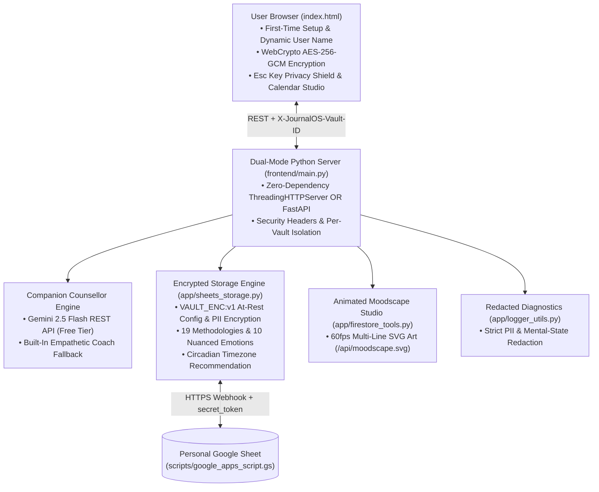

# 🌿 JournalOS Sanctuary — Technical & Developer Guide

<p align="center">
  
</p>

**JournalOS Sanctuary** is a **100% free, open-source, privacy-first Mindful AI Journaling Web Application**. It combines an empathetic **Companion Counsellor** persona, **19 evidence-based journaling frameworks**, **rate-limit-free animated SVG moodscapes**, **client-side AES-256-GCM encryption**, and **Google Sheets / local vault persistence**.

---

## 🧩 System Architecture



---

## 📂 Repository Structure

```text
journalos/
├── app/
│   ├── agent.py              # Optional ADK Agent definition (Gemini 2.5 Flash)
│   ├── a2ui_utils.py         # A2UI v0.8 card schema validator & callback
│   ├── firestore_tools.py    # 19-methodology prompt engine & multi-line animated SVG moodscapes
│   ├── logger_utils.py       # Rotating file + JSONL logger with strict PII redaction
│   └── sheets_storage.py     # Encrypted vault storage, Google Sheets sync & streak analytics
├── frontend/
│   ├── main.py               # Dual-mode HTTP/FastAPI server (runs with zero pip dependencies)
│   └── static/
│       ├── index.html        # Single-page Sanctuary UI, Onboarding Modal & WebCrypto AES-256-GCM
│       └── logo.svg          # Custom JournalOS Sanctuary vector logo & browser tab favicon
├── scripts/
│   └── google_apps_script.gs # Free Google Sheets Web App database connector
└── tests/
    └── unit/
        └── test_dummy.py     # Unit tests for 19 frameworks, SVG wrapping, encryption & privacy
```

---

## ⚡ Running Locally & Testing

### Start the Web App
```bash
python frontend/main.py
```
Then open **http://localhost:8080**.

### Run Unit Tests
```bash
python -m unittest tests/unit/test_dummy.py -v
```
